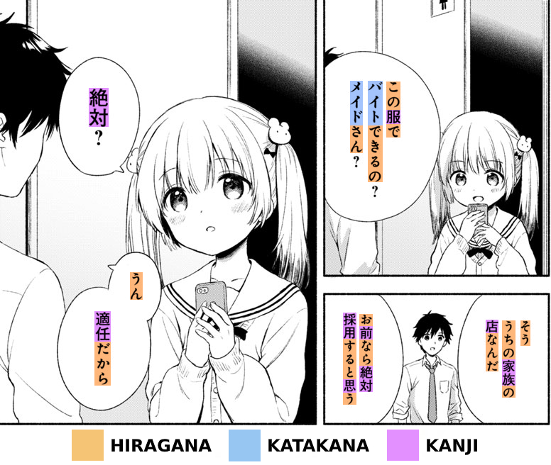

Ниже кратко описан типичный путь изучения японского,
который должен привести вас к свободному владению языком менее чем за два года.
Мы разработали этот метод для тех, кто хочет эффективно изучать японский самостоятельно
и интересуется японскими фильмами, сериалами, романами и другими произведениями.

Если у вас возникнут вопросы,
вы можете [задать их в нашем чате](join-our-community.html),
и вам помогут.
Тысячи людей изучают японский c нами, и вам стоит присоединиться к нашему сообществу.

****

## Правильный настрой

> Я всего лишь человек, который взял чужие идеи,
> систематически применял их и добился успеха.
>
> *Khatzumoto*

Язык усваивается через восприятие речи и текста (input).
Как вы знаете, младенцы умеют только плакать и пачкать подгузники,
но за первые несколько лет жизни они учатся говорить на родном языке.
Они быстро усваивают сложные грамматические принципы
и вскоре начинают говорить грамматически правильно и с почти идеальным произношением.
Это происходит потому, что они слушают окружающих, особенно родителей,
и постепенно начинают понимать сказанное.
Наш мозг устроен так, чтобы делать это инстинктивно.

Сторонники традиционного изучения языков говорят, что по мере взросления
часть мозга, отвечающая за усвоение языка (language acquisition), отмирает и становится недоступной.
Они настаивают, что взрослые должны изучать языки так же, как математику или естественные науки:
с помощью рационального, логического мышления, сознательно заучивая правила и выполняя упражнения.
Было доказано, что это не так.

Согласно Стивену Крашену, люди усваивают язык, когда понимают сообщения на нём.
Крашен называет это [понятным входным материалом](what-is-comprehensible-input.html)
(comprehensible input).
Процесс усвоения второго языка похож на процесс,
через который **проходят дети**, осваивая родной язык.
Вы можете делать это независимо от того, [сколько вам лет](im-not-a-kid-anymore-am-i-too-old-to-learn-a-language.html).

Мы не младенцы, мы умнее и можем учиться быстрее.
Любой взрослый с небольшой помощью технологий может усвоить язык через восприятие речи и текста,
занимаясь иммерсией (immersion).
Усвоение языка нельзя заменить его *изучением* (learning),
например посещением занятий или покупкой учебников.
Иммерсия является важнейшей составляющей всего процесса.

## Как заниматься иммерсией

Когда новички слышат слово «иммерсия», они часто ошибочно думают,
что достаточно [поехать в страну](https://www.antimoon.com/other/myths-country.htm),
находиться там, где говорят на изучаемом языке (target language),
и попросить японца с ними поговорить.
В AJATT мы считаем такой подход довольно плохим, непрактичным и неэффективным.
Вместо этого мы создадим собственную среду для японской иммерсии (Japanese Immersion Environment)
у себя дома.
Здесь под [иммерсией](whats-immersion.html) подразумевается любое слушание или чтение на изучаемом языке.
Метод AJATT предлагает сделать японский частью повседневной жизни с помощью разных видов контента,
например просмотра японских фильмов и сериалов, чтения книг и манги.
Метод позволяет заниматься иммерсией в язык и культуру,
не отправляясь в Японию и не посещая традиционные занятия.
Лучше всего использовать то, что вам по-настоящему интересно.
Подойдёт всё, что создано **носителями для носителей**.
Просто окружите себя контентом на японском, и вы усвоите язык.

Процесс делится на два шага.

1) Посмотрите фильм или серию сериала на японском.
   Видеоряд поможет вам понять происходящее.
   Если есть японские субтитры, используйте их для поиска незнакомых слов и грамматики.
   Если их нет, вы можете удивиться тому, как много можно усвоить,
   просто смотря *в оригинале*, без субтитров (raw).
   Это называется **активной иммерсией** (active immersion).
2) Повторно используйте просмотренное для **пассивной иммерсии** (passive immersion).
   Пассивная иммерсия это воспроизведение аудио в фоновом режиме,
   пока вы занимаетесь чем-то другим.
   Среди последователей AJATT распространена такая практика:
   взять просмотренную серию сериала, извлечь звуковую дорожку и добавить её в плейлист.
   Я расскажу, как это сделать, в статье о [пассивном слушании](passive-listening.html)
   (passive listening).

К чтению всё вышесказанное тоже применимо, если к прочитанной книге вы найдёте аудиокнигу.
Если нет, просто читайте и пропустите второй шаг.

Возникает закономерный вопрос: как учиться на контенте для носителей,
[если вы пока ничего не понимаете](is-it-helpful-to-immerse-if-i-barely-understand.html)?
Действительно, активно смотреть и читать такой контент, искать значения слов
и пытаться их выучить для новичка очень трудно.
Первые недели вы будете изучать основы языка.
На этом этапе время активной учёбы будет включать изучение азбук,
кандзи, базовой лексики и грамматики.
Тем не менее заниматься иммерсией нужно с первого дня.
На этом этапе я рекомендую смотреть простое аниме без субтитров.
Вместо поиска значений слов опирайтесь на видеоряд и контекст, чтобы понять происходящее.
Вы можете начать использовать японские субтитры, когда освоите основы японской письменности.
После просмотра каждой серии слушайте её пассивно,
чтобы проводить с иммерсией как можно больше времени.
Просто слушая, вы постепенно научите мозг лучше разбирать и понимать язык.
Если вы будете много слушать, со временем вы начнёте понимать устную речь,
будь то разговор или ваше любимое аниме.

Освоив базовую лексику, вы сможете учиться исключительно с помощью иммерсии.
Не откладывайте это надолго.
Некоторые загоняют себя в ловушку мыслями вроде
«Я начну смотреть аниме без субтитров, когда буду хорошо знать язык»
или «Я не занимаюсь иммерсией, потому что пока не понимаю японский».
Это очень опасный образ мыслей.
Вы надеваете коньки ещё до того, как научитесь кататься.
Вы начинаете смотреть без субтитров ещё до того, как начнёте понимать.

Для пассивного слушания старайтесь выбирать материал,
который вы до этого активно смотрели и поняли.
Качество пассивной иммерсии ниже, если вы заранее не поработали с материалом активно.
Избегайте слушания «белого шума»: настоящий прогресс происходит только тогда,
когда вы понимаете воспринимаемую речь.
Сразу понять всё не получится, но по мере изучения новых слов во время иммерсии
можно ожидать быстрого роста понимания в первые несколько месяцев.
Нужно прилагать усилия, чтобы материал стал понятным.
Ищите значения слов, опирайтесь на видеоряд, выбирайте материалы с более простым языком.

На начальном этапе проще всего учиться по аниме в жанре повседневности.
Чтобы найти простое аниме, можно [воспользоваться поиском на MAL](what-good-things-are-there-to-watch-for-a-complete-beginner.html).
Кроме того, на сайте ixrec есть страница с [рекомендациями контента](https://ixrec.neocities.org/immersion/).

Чем больше *речи на единицу времени* в вашем контенте для иммерсии, тем лучше.
Стоит выбирать контент, в котором много говорят, но есть несколько оговорок.

* В целом подкасты и радио сложнее для новичков, а текстовые расшифровки к ним встречаются редко.
  Учиться по такому контенту труднее, чем, например, по аниме,
  где можно открыть файл субтитров и найти значения незнакомых слов.
  Я рекомендую подкасты учащимся среднего уровня и выше.
* В [песнях](is-music-a-good-way-to-learn-japanese.html) встречаются неестественные конструкции предложений,
  грамматика и выбор слов.
  В них чаще используются «поэтические», редкие слова.
  Иногда, если у слова несколько чтений, для песни выбирают менее распространённое.

  За музыкой трудно расслышать слова.
  Даже на родном языке мы часто не можем расслышать или понять отдельные части песен.
  Вместо слушания песен ради иммерсии лучше выбрать более понятный материал.

  Но музыка приносит удовольствие.
  Чтение текстов песен позволяет с интересом находить новые, часто классные и редкие слова.
  Попробуйте это, когда достигнете продвинутого уровня.

Надеюсь, вы найдёте режим иммерсии, который впишется в вашу жизнь.
Если вам кажется, что у вас не получится, не переживайте.
Даже Khatz, основатель AJATT, писал в своём блоге,
что ему не всегда удавалось заниматься иммерсией весь день.
При этом он старался делать всё возможное, одновременно работая и учась в университете.
AJATT существует много лет, и многие люди прошли этот путь и достигли свободного владения языком.

## Говорение

В AJATT *говорить* (to output) означает просто пользоваться изучаемым языком в речи,
общаться с носителями.
Многие люди, изучающие иностранные языки, стремятся начать говорить с первого дня.
К сожалению, этот подход не очень хорошо работает.
Особенно для тех, кто стремится к настоящему мастерству владения языком.
Хотя заучивание готовых фраз и их отработка могут помочь в самых простых разговорах,
этот метод не обеспечивает устойчивого прогресса в долгосрочной перспективе.

Один из основных принципов философии AJATT заключается в том,
что восприятие языка должно предшествовать его использованию в речи.
По сути, если вы хотите свободно владеть иностранным языком,
эффективнее всего полностью сосредоточиться на том, чтобы научиться понимать его
через слушание, а затем и чтение.
Это так называемый период молчания (silent period): вы уже усваиваете язык, но ещё не говорите на нём.
Такой период можно наблюдать и у младенцев.
Они не говорят с первого дня.
Они усваивают язык, прежде чем начинают говорить.

Главная цель состоит в том, чтобы сначала научиться понимать язык.
Без понимания успешно общаться с другими трудно,
даже если вы выучили базовые фразы из учебника.

[Преждевременное говорение](can-i-speak-early.html) (premature output)
может иметь и другие негативные последствия,
например повлиять на произношение и закрепить распространённые ошибки.
Эти последствия часто заметны в речи тех, кто изучает языки традиционными методами.

* Нужно время, чтобы натренировать понимание на слух настолько,
  чтобы разбирать речь носителей в естественном темпе и понимать её.
  Если вы пока не различаете звуки, то не сможете повторить их без сильного иностранного акцента.
  Те, кто изучает языки традиционными методами, начинают говорить очень рано, с первого дня.
  Говоря, они привыкают произносить слова неправильно.

  Вспомните японцев.
  Из-за вреда, нанесённого школьной системой,
  которая не даёт и не может дать достаточно практики слушания,
  они путают звуки `l` и `r`, когда пытаются говорить по-английски.

  Многие думают: «Я попрошу носителей исправлять меня и говорить, где я ошибаюсь».
  Представьте незрячего человека, который пытается нарисовать автопортрет,
  а кто-то ему говорит: «Ой, нос немного больше».
  Это ему не очень поможет.

  Если вы хотите хорошее произношение, нужно полагаться на собственную способность исправлять себя.
  Прежде чем начинать говорить, нужно хорошо развить понимание на слух.
* Ошибки плохи тем, что [становятся привычками](http://www.antimoon.com/how/mistakes-damage.htm).
  Когда вы только начинаете изучать новый язык, вы будете делать много ошибок в попытках говорить.
  Если вы ошиблись один раз, то с большей вероятностью повторите ту же конструкцию в следующий раз.
  Многократное повторение одних и тех же ошибок превращает их в укоренившиеся привычки,
  от которых потом бывает очень трудно избавиться.

  Не надейтесь, что носитель исправит ваши ошибки.
  Если собеседник хоть как-то вас понял, он не станет указывать, где вы ошиблись.
  Даже если вы попросите исправлять все ваши ошибки,
  нет гарантии, что вы сможете применить эти исправления.

## Пройдите через период молчания

Избегайте говорения на изучаемом языке,
пока способность говорить не разовьётся естественным образом.
Обычно это происходит примерно через год занятий по методу AJATT.

Если вы хотите хорошо звучать, практиковаться в говорении всё равно придётся.
Одной иммерсии недостаточно, чтобы заговорить как носитель.
Но на начальном этапе это не должно быть вашей главной задачей.

## Способность говорить возникает естественным образом

После нескольких тысяч часов восприятия языка способность говорить начнёт постепенно проявляться.
Попытки форсировать этот процесс обычно не работают.
Ещё раз вспомните, **как маленькие дети учатся** говорить на родном языке.
Их способность говорить возникает в результате иммерсии.

1) Иммерсия + [система интервального повторения](spaced-repetition.html) (spaced repetition system, SRS) = способность понимать.
1) Иммерсия + способность понимать = способность говорить.
1) Способность говорить + практика = мастерство говорения.

## Говорение с самоконтролем

Когда вы начнёте замечать, что способность говорить появилась,
можно приступать к практике говорения с самоконтролем (controlled output).
Если вы уже **хорошо понимаете язык**, ваш слух должен быть достаточно натренирован,
чтобы вы могли замечать и исправлять ошибки, слушая запись собственной речи.

Вы можете практиковать говорение, повторяя вслух предложения из записей речи носителей,
например отрывков из аниме, сериалов или фильмов.
Эта техника называется «упражнением на подражание» (imitation exercise).
Подражание заключается в том, чтобы слушать запись речи носителя и повторять сказанное,
стараясь как можно точнее воспроизвести темп, ритм и интонацию.
Записывайте себя и обращайте внимание на своё произношение.
Старайтесь исправлять все замеченные ошибки.

Также полезно начать писать статьи в блоге и сочинения.
Всегда проверяйте правильность своей речи и текстов, контролируйте себя.
Исправляйте ошибки, когда находите их.
Вы можете попросить носителей **проверить** и исправить ваши сочинения
или воспользоваться автоматизированными инструментами
(например, [Duck.ai](http://duck.ai/), чат-ботом с ИИ, который можно попросить проверить текст).

Помните, что нельзя практиковать говорение, пока вы не научитесь очень хорошо понимать на слух.
Если вы начнёте говорить до того, как сможете различать все звуки изучаемого языка,
вы закрепите плохие привычки, которые потом будет почти невозможно исправить.
Каждый раз, когда вы произносите что-то неправильно,
вы приучаете мозг запоминать это искажённое произношение.

**Если говорение для вас не главное**, вы можете пренебречь его практикой.
Однако данные показывают,
что слишком долгое избегание практики говорения имеет негативные последствия.
Если вы никогда не пытаетесь говорить, ваша способность к этому останется неактивной.
Тогда, когда вы наконец решите заговорить, вы окажетесь не готовы.
Ваша способность говорить может напоминать высохший лимон:
выдавить из себя хоть какие-то слова будет очень трудно.

## Обзор программ

Мы будем использовать разные программы, которые помогут нам с японским.
Поскольку это вводная статья, устанавливать всё прямо сейчас не нужно.
Это лишь общий обзор.
Самые важные инструменты описаны в статье [«Наш набор инструментов для иммерсии»](our-immersion-learning-toolset.html).
Затем вас ждут статьи с подробными инструкциями по их использованию.
Кроме того, дополнительные рекомендации есть в [списке ресурсов](resources.html)
и в остальных частях руководства.

### Компьютер

  * Установите японские шрифты.
    Я рекомендую [noto-fonts-cjk](https://archlinux.org/packages/?name=noto-fonts-cjk).
    Подробные инструкции приведены в статье [«Японские шрифты»](japanese-fonts.html).
  * Установите и настройте [Fcitx](https://wiki.archlinux.org/title/Fcitx5),
    чтобы печатать по-японски.
    Руководство по Fcitx находится [здесь](how-to-type-in-japanese.html).
    Я использую метод ввода [fcitx-kkc](https://archlinux.org/packages/?name=fcitx-kkc),
    но есть и другие варианты.
  * Для пассивной иммерсии используйте [mpd](https://wiki.archlinux.org/title/Music_Player_Daemon)
    вместе с [ncmpcpp](https://wiki.archlinux.org/title/Ncmpcpp).
    Храните материалы для иммерсии в отдельной папке, например `~/Music/immersionpod`.
  * *Сжимайте* материалы для иммерсии (condensing) с помощью [impd](https://github.com/Ajatt-Tools/impd).
    При сжатии из видеофайла с субтитрами удаляются все фрагменты, где никто не говорит,
    и получается аудиофайл с большей плотностью речи для пассивного слушания.
  * Самый рекомендуемый видеоплеер: [mpv](https://wiki.archlinux.org/title/Mpv).
    Он поддерживает [дополнения](https://github.com/mpv-player/mpv/wiki/User-Scripts)
    (пользовательские скрипты), многие из которых облегчают изучение языков.
  * Установите и [настройте](setting-up-anki.html) Anki.
    Это программа с карточками для запоминания слов, выражений и предложений.
  * Самые популярные офлайн-словари:
    1) [qolibri](setting-up-qolibri.html).
    1) [GoldenDict](setting-up-goldendict.html)
    1) [Tagaini Jisho](https://www.tagaini.net/)
  * При чтении в браузере используйте [Rikaitan](setting-up-yomichan.html),
    чтобы узнавать значения незнакомых слов.

### Мобильные устройства

  * Установите [Mozc для Android](https://f-droid.org/en/packages/org.mozc.android.inputmethod.japanese/),
    чтобы печатать по-японски.
    Поскольку на Android не хватает свободных клавиатур, при желании можно использовать и `Gboard`,
    но обязательно полностью запретите ей доступ в интернет.
  * [AntennaPod](https://f-droid.org/en/packages/de.danoeh.antennapod/)
    отлично подходит для воспроизведения подкастов.
    Для начала можно воспользоваться [этим списком](https://t.me/ajatt_tools/80) подкастов.
  * Установите [AnkiDroid](https://f-droid.org/en/packages/com.ichi2.anki/).
    Никакой особой настройки не требуется,
    кроме ввода данных учётной записи AnkiWeb для синхронизации с компьютером.
  * Из офлайн-словарей японского доступны
    [Sumatora](https://f-droid.org/en/packages/org.happypeng.sumatora.android.sumatoradictionary/),
    [jiten](https://github.com/obfusk/jiten)
    или другие варианты, которые вы найдёте на F-Droid.

### Что не следует использовать

  * [Машинные переводчики](could-machine-translation-be-useful-to-language-learners.html).
    Любой перевод отличается от исходной мысли,
    потому что ни у одного слова нет точного эквивалента в другом языке.
    Японские именные суффиксы, уровни вежливости и другие особенности
    отсутствуют в английском и теряются при переводе.

    Чтобы по-настоящему понять что-либо на изучаемом языке,
    нужно с самого начала понимать это именно на нём.
    Для этого нужно получить тысячи часов понятного входного материала
    и усвоить необходимую лексику и грамматику.

    Машинные переводы часто неестественны, ошибочны или вводят в заблуждение.
    Хотя они могут дать общее представление о сказанном,
    они не способны передать весь смысл и все детали исходного сообщения.
    Допустимо использовать машинный перевод для отдельных слов,
    хотя надёжнее всё же обратиться к словарю.

    Google Переводчик хорошо распознаёт нарисованные иероглифы.
    Его можно использовать, чтобы получить текстовую запись кандзи,
    который нельзя скопировать и вставить (например, при чтении манги),
    а также когда программы оптического распознавания символов (OCR) с этим не справляются.
  * Платные программы.
    Среди платных программ для изучения языков нет таких,
    которые предлагали бы уникальные функции, отсутствующие в бесплатных аналогах
    и при этом не являющиеся бесполезными с нашей точки зрения.
    К тому же, если вы собираетесь изучать японский десять лет,
    вы действительно хотите платить всё это время?
  * Проприетарные программы.
    Большинство [проприетарных программ вредоносны](https://www.gnu.org/proprietary/proprietary.html),
    такова реальность, в которой мы живём.

## Системы письменности

В современном японском используются три системы письменности: хирагана, катакана и кандзи.
Хирагана и катакана представляют собой две фонетические азбуки, в каждой из которых 46 знаков.
Кандзи пришли из китайского языка и представляют собой сложные знаки, обозначающие понятия.

### Кана

Ознакомьтесь со статьями Википедии о [хирагане](https://wikipedia.org/wiki/Hiragana?lang=en)
и [катакане](https://wikipedia.org/wiki/Katakana?lang=en), чтобы понять, с чем вам предстоит иметь дело.
Вместе они называются [каной](https://wikipedia.org/wiki/Kana?lang=en).
Вот что важно запомнить:

* Обе азбуки обозначают одни и те же звуки.
  Катакана в основном используется для записи заимствований и звукоподражаний,
  а хирагана для всего остального, что не записывается кандзи.
* Из-за своего назначения катакана используется реже хираганы,
  что вы заметите, когда начнёте читать.
* Они очень простые.
  Каждую можно выучить за день.
* Любой японский текст, не предназначенный для дошкольников, содержит кандзи,
  поэтому одной каны будет недостаточно.

В статье об изучении каны (далее в этом руководстве)
я рекомендую использовать приложение-тренажёр или готовую колоду Anki.
В любом случае на это уйдёт около двух дней, а если будете лениться, не больше недели.

### Кандзи

[Кандзи](https://wikipedia.org/wiki/Kanji?lang=en) были заимствованы из Китая давным-давно.
Это логографические знаки, используемые для записи слов и частей слов.
Чтобы по-настоящему освоить кандзи, нужно тысячи часов читать тексты для носителей японского.
Изучение кандзи призвано подготовить мозг к распознаванию иероглифов и облегчить переход к чтению.

Самый новый метод изучения кандзи называется [JP1K](learning-kanji.html#jp1k-method).
По сути, это колода Anki со специальным форматом карточек.
В колоде около 1000 карточек, отсюда и название JP1K.
С форматом колоды связана особая техника занятий.
Изучив все карточки колоды, вы сможете узнавать самые распространённые кандзи
вместе со словами, в которых они встречаются.
На этом сайте вы найдёте ссылки на готовые колоды JP1K,
а также инструкции по преобразованию любой словарной колоды в формат JP1K.

Есть и другие, более старые методы изучения кандзи.
Один из самых известных называется [изолированным изучением кандзи](learning-kanji.html#isolated-kanji-study)
(isolated kanji study).
Хотя в AJATT мы не особо рекомендуем этот метод, некоторым учащимся он всё же может быть интересен.

Выберите только один из перечисленных методов.
Какой бы вариант вы ни выбрали, пока не утруждайте себя изучением написания иероглифов.
Чтобы учиться писать от руки, сначала нужно уметь хоть немного читать по-японски.
Есть более эффективные способы научиться писать,
о которых мы [поговорим](writing-japanese.html) позже на этом сайте.

<i>Системы японской письменности.</i>

Вы можете полностью пропустить этап изучения кандзи и сразу перейти к базовой лексике.
В таком случае вы будете запоминать слова как есть, вместе с кандзи.
Для каждого слова просто старайтесь запомнить, как оно выглядит, что означает и как звучит.
Воспринимайте кандзи как картинки и запоминайте сочетания кандзи как единое целое.
Безусловно, это сложнее, но многим такой подход подходит.

## Базовая лексика

Познакомившись с системами письменности,
используйте готовую колоду Anki для освоения базовой лексики.
Завершение этого этапа облегчит обучение через восприятие языка:
вам не придётся мучиться с поиском каждого слова на каждой странице.

Скачайте [Ankidrone Essentials](ankidrone-essentials.html) и выучите из неё одну-две тысячи карточек.
Вы можете продолжать изучать новые карточки из этой колоды,
но не застревайте на этом этапе и как можно скорее переходите к созданию карточек из предложений,
о котором пойдёт речь ниже.

На лицевой стороне каждой карточки *Ankidrone Essentials* есть предложение.
Целевое слово (target word) карточки выделено жирным.
На обороте приведена информация, необходимая для понимания предложения и целевого слова,
включая приблизительный перевод и чтения кандзи.
Ваша цель состоит в том, чтобы понять целевое слово.
При желании можно даже не читать предложение,
но пренебрежение контекстом слова может усложнить повторения.

## Грамматика

Дети не учат грамматические правила по книгам.
Они учатся, слушая огромное количество понятной им речи.
Со временем их мозг самостоятельно разбирается в устройстве языка.
Ваша задача на этом этапе состоит в том, чтобы прочитать руководство по грамматике,
лишь бегло просматривая правила.
Вам нужны примеры предложений.
В хорошей книге по грамматике должно быть много примеров, которые вы сможете усвоить.

[Выберите руководство по грамматике](learning-grammar.html) и прочитайте его.
Это единственный *учебник*, который вам действительно понадобится на всём пути AJATT.
Когда я изучал японский, я выбрал руководство Tae Kim.
Khatz использовал «[All About Particles](all-about-particles.html)».

Сочетание изучения грамматики с SRS может помочь лучше её понять.
При желании добавляйте предложения-примеры в Anki.
Выделяйте грамматическую конструкцию в предложении, чтобы обозначить её как целевой элемент.
Так оформляются [целевые карточки с предложениями](discussing-various-card-templates.html#targeted-sentence-cards)
(targeted sentence cards, TSC), о которых пойдёт речь ниже.
Если вы решите пока не возиться с Anki,
обязательно хотя бы прочитайте руководство по грамматике целиком и обратите внимание на примеры.

Не тратьте время на заучивание таблиц спряжения.
Грамматика служит инструментом для облегчения понимания,
а знание правил не поможет вам говорить.
Пока вы вспомните грамматическое правило и примените его к своей мысли,
собеседник уже давно уйдёт.

Руководство вроде Tae Kim не охватывает всё.
Даже некоторые конструкции из раздела для продвинутых можно считать довольно базовыми.
Продолжая заниматься иммерсией, ищите объяснения остальной грамматики,
не вошедшей в руководство, и при необходимости создавайте для неё карточки Anki.
Процесс ничем не отличается от создания карточек для обычных слов.

## Создайте собственную колоду

Процесс создания карточек с предложениями (sentence cards) или целевых карточек с предложениями
для незнакомых слов называется [созданием карточек из предложений](sentence-mining.html)
(sentence mining, также sentence picking, то есть отбор предложений).
Такая колода Anki (mining deck) создаётся вами самостоятельно, а не скачивается из интернета,
и наполняется предложениями (реже словами) из контента,
который вы читаете или смотрите с субтитрами.
Таким образом, вы «добываете» предложения из настоящих текстов, которые встречаете сами.

Хотя готовые колоды Anki могут казаться удобными, они не могут научить вас всему,
поэтому создание собственных карточек необходимо для долгосрочного успеха в японском.
Продолжайте заниматься иммерсией,
читая и слушая контент, созданный носителями для носителей,
и используйте [словари](resources.html#dictionaries) для поиска новых слов и отбора предложений.

Не создавайте слишком много карточек с отдельными словами (single word flashcards).
Они подходят для существительных, обозначающих конкретные предметы,
но плохо подходят для других частей речи.
Не переводите предложения.
Вместо этого понимайте их.

В сообществе популярна цель создать 10 000 карточек за первые 18 месяцев.
Хотя в этом числе нет ничего особенного, наличие цели может мотивировать.
Мне удалось выучить 10 000 карточек с предложениями за 11 месяцев.
Вы тоже можете принять этот вызов,
но помните, что Anki лишь дополняет обучение через иммерсию.

## Иммерсия через чтение и иммерсия через слушание

AJATT основан на изучении языков естественным путём, **как это делают дети**.
Однако, хотя иммерсия через чтение (reading immersion) очень эффективна
и помогает быстро прогрессировать,
дети на самом деле учат языки не так.
Они годами осваивают устную речь **прежде, чем прочитают хотя бы один письменный знак**.
Сначала они формируют звуковую основу, а потом учатся читать.

Чтение на иностранном языке [вредит](why-does-premature-reading-cripple-phonetic-awareness.html)
**восприятию** и **произношению**.
Влияние на восприятие сказывается на плавности речи,
то есть на том,
насколько быстро и легко вы можете строить предложения в голове по сравнению с носителями.
Влияние на произношение сказывается на том,
как вы звучите и чем ваше произношение отличается от произношения носителей.

Носители обрабатывают язык подсознательно.
Их речь автоматична и течёт свободно,
без сознательного внимания к структуре или порядку слов.
Напротив, учась через чтение, вы анализируете язык
и задействуете другие части мозга, не те, что носители.
По сути, вы учитесь переводить язык в собственную мысленную модель,
а не понимать его интуитивно.
Это ограничивает вашу способность говорить естественно и свободно.

Взрослые, которые пренебрегают слушанием и полагаются в основном на чтение,
часто хорошо осваивают грамматику, но сохраняют **иностранный акцент**.
Часто это связано с **[субвокализацией](https://en.wikipedia.org/wiki/Subvocalization)** (subvocalization).
То есть чтение активирует мышцы горла.
Без прочной основы в слушании учащиеся придумывают звуки у себя в голове во время чтения,
формируя **плохие привычки произношения**.
Этот эффект похож на последствия [преждевременного говорения](#govorenie).
Поскольку тренировка понимания на слух требует больше усилий,
навык чтения у них быстро обгоняет навык слушания.
Каждый раз, когда они видят слово в тексте,
их мозг создаёт выдуманное произношение на основе того, как, *по их мнению*, оно должно звучать,
и они проговаривают его про себя, фактически тренируясь звучать плохо.
Научившись читать до того, как они смогут **правильно слышать** язык,
они подрывают собственную способность говорить.

Чтобы развить понимание на слух и хорошее произношение,
начните **только с аудиовизуального материала** (сериалов, фильмов, аниме, дорам).
Полностью избежать чтения трудно,
поэтому старайтесь ограничить его поиском незнакомых слов в японских субтитрах,
использованием словарей и созданием карточек Anki.

Улучшать понимание на слух после нанесённого вреда будет очень трудно,
потому что звуки у вас в голове не будут совпадать с тем, что на самом деле произносят носители.
Такого исхода нужно избежать любой ценой.

Вначале ограничьте чтение **только** карточками и поиском в словарях,
чтобы тренировать понимание на слух.
Избегайте активного чтения за пределами текстовых карточек.
**Сосредоточьтесь на слушании** большого количества речи носителей японского,
чтобы сформировать фонетическую основу.
Когда вы научитесь хорошо понимать на слух, добавьте лёгкое чтение,
например простые комиксы или мангу, а затем переходите к ранобэ и романам.

Просмотр аниме с японскими субтитрами тоже [считается чтением](is-watching-anime-with-jp-subtitles-considered-as-reading.html).
Японские субтитры служат костылём, который помогает искать новые слова,
но не улучшает способность понимать изучаемый язык на слух.
Они **заманчивы**, потому что смотреть без субтитров трудно.
Ограничивайте их использование, чтобы тренировать понимание на слух.

Если вы изучаете японский прежде всего **ради удовольствия от контента**,
например аниме, манги или ранобэ, и не собираетесь переезжать в Японию,
то на самом деле [эффективнее](how-much-listening-should-i-do-before-i-start-reading.html)
начать читать мангу и романы пораньше.
Взрослому значительно легче изучать иностранные языки через чтение,
чем через слушание устной речи.
Вы сможете прогрессировать гораздо быстрее.
Над акцентом можно поработать и позже, но его исправление потребует значительных усилий.

## Как распределить время занятий

Изучение языка включает три основные составляющие:

* Повторение карточек.
* Иммерсия через чтение.
  Просмотр с субтитрами на изучаемом языке
  ([никогда не с субтитрами на родном языке](should-i-watch-anime-with-english-subtitles.html)),
  чтение манги и книг.
* Иммерсия через слушание (listening immersion).
  Просмотр без субтитров, слушание аудиокниг, радио и подкастов.

Естественно, люди [часто спрашивают](how-should-i-divide-my-study-time.html),
как эффективно распределять время занятий.

Общая рекомендация состоит в том, чтобы делить время поровну между слушанием и чтением
(сохраняя соотношение `1:1`), дополнительно выделяя час на карточки.
Однако новичкам стоит уделять **слушанию** больше времени, чем чтению,
а продвинутым учащимся **чтение** принесёт больше пользы, чем слушание.

Для новичков чтение сложнее и [может иметь негативные последствия](thoughts-on-reading-before-listening.html),
которых большинство хотело бы избежать.
Чтение приводит к субвокализации.
Сам процесс чтения активирует мышцы горла.
Если у человека пока нет приличного произношения,
субвокализация закрепит плохие привычки произношения
и дополнительно ухудшит восприятие устной речи.
Но обучение через чтение позволяет быстрее осваивать лексику,
потому что слова уже записаны, их не нужно разбирать на слух и можно читать в своём темпе.
Обучение через слушание занимает больше времени, но не имеет такого негативного воздействия.
Слушание тренирует слух и улучшает способность понимать устную речь.

Итак, рекомендуется начинать только с **иммерсии через слушание**.
Например, начните с просмотра простого аниме.
Учтите, что субтитры нужны для поиска незнакомых слов,
но [необязательно держать их на экране постоянно](is-it-harmful-to-always-have-tl-subtitles-on.html).
Затем постепенно включайте **иммерсию через чтение** в свой распорядок.
По мере прогресса увеличивайте время, отведённое на чтение.
Корректируйте соотношение в зависимости от своих личных целей.

Мы рекомендуем тратить на карточки не больше **одного** часа в день по двум основным причинам.
Во-первых, большинство людей считают SRS (системы интервального повторения) довольно скучными.
Во-вторых, SRS служит лишь дополнением.
Она помогает укрепить память, но усвоение языка происходит только во время иммерсии.

Просмотр с субтитрами считается иммерсией через чтение,
потому что чтение субтитров создаёт внутренний голос,
который конкурирует с речью на изучаемом языке.
В результате вы не слушаете активно речь носителей,
а сосредотачиваетесь на внутреннем проговаривании во время чтения субтитров.
